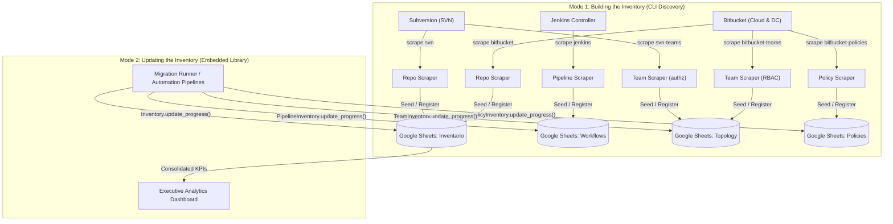

# GitHub Migration Inventory Manager

**GitHub Migration Inventory Manager** is a specialized CLI tool and Python library designed to automate the discovery of source code repositories (Subversion / SVN, Bitbucket), CI/CD pipelines (Jenkins), access topologies, and branch governance policies. It registers and maintains a centralized inventory in Google Sheets and programmatically tracks migration lifecycles during large-scale enterprise GitHub migrations.

---

## Why It Was Created

In enterprise GitHub migration initiatives, organizations often need to migrate hundreds or thousands of repositories and CI/CD workflows scattered across legacy VCS platforms (e.g., Subversion / SVN, Bitbucket Cloud, Bitbucket Data Center / Server) and CI/CD controllers (e.g., Jenkins). These migrations present critical operational challenges:

- **Lack of Central Visibility Across Four Key Dimensions**:
  1. **Repositories & Stacks**: Undocumented repositories, heterogeneous directory structures (multi-project SVN, flat trees), and unidentified technology stacks.
  2. **CI/CD Pipelines**: Deeply nested Jenkins job folders, disparate pipeline archetypes (Declarative, Scripted, Multibranch, Freestyle), and unmapped repository linkages.
  3. **Access Topology & RBAC**: Diverse permission models (SVN `authz` paths, Bitbucket project/repo group permissions) that must be mapped to GitHub Organization Teams and normalized roles (`Admin`, `Maintain`, `Write`, `Triage`, `Read`).
  4. **Branch Governance & Policies**: Branch protection rules, minimum approval requirements, and required build checks in source platforms that must be translated into GitHub Rulesets.
- **Tracking Migration Progress Across Lifecycle States**: Migrations are iterative, phased operations rather than instantaneous cutovers. Repositories, workflows, and governance items transition through progressive lifecycle stages:
  1. `Aguardando Migração` (*Waiting*): Discovered in the legacy system and queued for migration.
  2. `Migrando (Ativos em Ambas)` (*Active in Both*): Synchronized or mirrored to GitHub / GitHub Actions; active development or verification occurs in both systems during the transition window.
  3. `Migrados (Somente GitHub)` (*Migrated*): Migration complete and verified; the legacy origin repository or Jenkins job is deactivated or archived.
  4. `Ignorado` (*Skipped*): Deprecated, empty, or obsolete codebases and jobs explicitly excluded from migration.
- **Keeping the Inventory Continuously Up to Date**: Without automation, static tracking sheets fall out of sync immediately. Migration teams need a live, automated inventory connected directly into their migration pipelines to update statuses, record exact migration and deactivation dates, generate monthly cohorts, and provide executive visibility through real-time analytics.

---

## Two Core Modes of Operation

The project is structured around two distinct operational modes that cover the entire migration lifecycle:



### 1. Building the Inventory (Discovery & Scraper Mode)
- **Form**: Command-Line Interface (`gh-migration-inventory scrape <platform>`).
- **Role**:
  - **Repositories (`scrape svn`, `scrape bitbucket`)**: Discovers repositories, inspects structures, detects technology stacks (Java, Python, TypeScript/Node, C#/.NET Core, Bash, Terraform), extracts last commit dates, and seeds the `Inventario` tab.
  - **Workflows (`scrape jenkins`)**: Traverses Jenkins controllers, classifies pipeline archetypes, maps SCM URLs, checks build staleness, and seeds the `Workflows` tab.
  - **Team Topology (`scrape svn-teams`, `scrape bitbucket-teams`)**: Parses SVN `authz` or Bitbucket project/repo group permissions, normalizes roles into GitHub equivalents, tallies member counts without PII sprawl, and seeds the `Topology` tab.
  - **Branch Policies (`scrape bitbucket-policies`)**: Discovers push restrictions and PR merge checks (approvals, builds, comment resolution), and seeds the `Policies` tab.
- **Idempotency**: Discovery operations are non-destructive—newly discovered items are inserted, while existing records strictly preserve their migration status and historical timestamps.

### 2. Updating the Inventory (Lifecycle Tracking via Embedded Library)
- **Form**: Python library (`gh_migration_inventory_manager`) embedded directly into migration pipelines, GitHub Actions workflows, Jenkins jobs, or orchestration scripts.
- **Role**: Programmatically advances statuses as migration milestones complete (`waitting` → `active_in_both` → `migrated`) via [`Inventory`](src/gh_migration_inventory_manager/inventory.py), [`PipelineInventory`](src/gh_migration_inventory_manager/inventory.py), [`PolicyInventory`](src/gh_migration_inventory_manager/inventory.py), and [`TeamInventory`](src/gh_migration_inventory_manager/inventory.py). It automatically manages timestamps (`Data de Migração (GitHub)`, `Data de Desativação (Origem)`) and calculates the cohort month (`Mês de Migração`).

---

## Getting Started

### 1. Prerequisites
- Python `>= 3.10`
- [Poetry](https://python-poetry.org/) `>= 2.0`
- A Google Cloud Platform (GCP) project with the Google Sheets and Drive APIs enabled.

### 2. Prepare Google Cloud Credentials
1. In the [Google Cloud Console](https://console.cloud.google.com/), enable the **Google Sheets API** and **Google Drive API**.
2. Navigate to **IAM & Admin > Service Accounts** and create a service account (e.g., `github-migration-inventory@<your-project>.iam.gserviceaccount.com`).
3. Under the **Keys** tab, click **Add Key > Create new key > JSON**.
4. Download the JSON key file and store it securely (e.g., `./gcp-key.json`).

### 3. Prepare the Google Spreadsheet

You have two flexible options to set up the spreadsheet:

#### Option A: Copy the Official Pre-Configured Template (Recommended)
1. Open the [Example Google Spreadsheet Template](https://docs.google.com/spreadsheets/d/1Z0PAjv8KK6WBrS2356gtR3VE0ulD1-8LM4DPQiG-Nkk).
2. Click **File > Make a copy** to clone it to your Google Drive.
3. Share the spreadsheet with your GCP Service Account email address (found in `client_email` within `gcp-key.json`) and grant the **Editor** role.
4. Extract the **Spreadsheet ID** from the URL:
   ```text
   https://docs.google.com/spreadsheets/d/<SPREADSHEET_ID>/edit
   ```

#### Option B: Automatic Provisioning on a New or Existing Sheet
`gh-migration-inventory-manager` includes **automatic tab and header provisioning**:
1. Create a blank Google Spreadsheet (or use an existing team spreadsheet).
2. Share the spreadsheet with your GCP Service Account email and grant the **Editor** role.
3. Simply execute any scraper command with `--spreadsheet-id <ID>`. The tool will automatically create missing worksheets (`Inventario`, `Workflows`, `Topology`, or `Policies`) and initialize the exact header columns if they do not exist.

---

## Spreadsheet Structure & Schemas

The spreadsheet serves as the single source of truth across four structured tabs:

### 1. `Inventario` (Repositories & Stacks)
Populated by `scrape svn` and `scrape bitbucket`:
- `Projeto`: Project or workspace grouping key.
- `Nome do Repositório`: Repository slug or component identifier.
- `Tecnologia`: Detected technology stack (e.g., `Java`, `Python`, `TypeScript`, `C#`, `Terraform`, `Bash`).
- `Data do Último Commit`: UTC timestamp or formatted date of the latest commit on the source platform.
- `Data de Migração (GitHub)`: Date when the repository was migrated to GitHub.
- `Data de Desativação (Origem)`: Date when the legacy origin repository was deactivated.
- `Status da Migração`: Current lifecycle state (`Aguardando Migração`, `Migrando (Ativos em Ambas)`, `Migrados (Somente GitHub)`, `Ignorado`).
- `Mês de Migração`: Cohort month string (e.g., `Novembro/2026`).

### 2. `Workflows` (CI/CD Pipelines)
Populated by `scrape jenkins`:
- `ID do Workflow`: Full job path/identifier (e.g., `services/payment/payment-service-build`).
- `Plataforma`: CI/CD platform (`jenkins`, `gitlab`, `azure_devops`, `github_actions`).
- `Tipo de Pipeline`: Classification (`declarative`, `scripted`, `multibranch`, `freestyle`, `matrix`).
- `Repositório Associado`: Linked SCM repository name or identifier (`org/repo`).
- `URL do Repositório`: Git or SVN clone/remote URL for the repository.
- `Caminho do Workflow`: Path to workflow file in repository (e.g., `Jenkinsfile`).
- `Componentes Compartilhados`: Referenced shared libraries, templates, or reusable workflows.
- `Ambiente de Execução`: Runner labels, agent labels, or node pool demands.
- `Branch Padrão`: Target or default branch configured for the job (e.g., `main`).
- `Último Build`: Formatted date/timestamp of the most recent build execution.
- `Status do Último Build`: Outcome of the most recent build (`SUCCESS`, `FAILURE`, `UNSTABLE`).
- `Status da Migração`: Current lifecycle state (`Aguardando Migração`, etc.).

### 3. `Topology` (Team Permissions & RBAC)
Populated by `scrape svn-teams` and `scrape bitbucket-teams`:
- `Nome do Time`: Original team or group identifier from source.
- `Slug do Time`: GitHub-compatible lowercase hyphenated slug (e.g., `core-devs`).
- `Contagem de Membros`: Total active member count (aggregated to eliminate PII sprawl).
- `Repositório / Projeto`: Target repository path or project scope (`*` for global).
- `Papel Normalizado (GitHub)`: Normalized GitHub role (`Admin`, `Maintain`, `Write`, `Triage`, `Read`).
- `Papel de Origem`: Raw platform role or permission string (e.g., `PROJECT_ADMIN`, `rw`).
- `Status da Migração`: Current lifecycle state.

### 4. `Policies` (Branch Governance & Merge Checks)
Populated by `scrape bitbucket-policies`:
- `Escopo da Política`: Scope level (`project:<KEY>` or `repo:<KEY>/<SLUG>`).
- `Padrão de Ref / Branch`: Target branch pattern (e.g., `refs/heads/main`, `release/*`).
- `Tipo de Regra (GitHub)`: Normalized rule archetype (`pull_request`, `deletion`, `non_fast_forward`, `read_only`).
- `Parâmetros da Regra`: JSON or formatted rule parameters (e.g., `{"min_approvals": 2, "require_builds": true}`).
- `Slugs de Times de Bypass`: Comma-separated list of GitHub team slugs exempted from restrictions.
- `Política de Origem (Raw)`: Raw Bitbucket restriction or merge check payload.
- `Status da Migração`: Current lifecycle state.

### 5. `Analytics`
Consolidated executive dashboard with real-time charts:
- Inactive repository indicators (*Sem Commit há > 1 Ano*, *Sem Commit há > 6 Meses*).
- Migration status distribution pie/bar charts.
- Monthly cohort migration velocity.

---

## Platform Extraction Guides (CLI Discovery)

Discover remote repositories, pipelines, teams, and branch rules and synchronize them directly to Google Sheets:

### 1. Subversion (SVN)

#### A. SVN Repositories (`scrape svn`)
Scans SVN repositories or server directories, detects layouts (`standard`, `multi_project`, `flat`, `collection`), and detects root manifest stacks.
```bash
poetry run gh-migration-inventory scrape svn \
  --url https://svn.internal.company.com/svn/core-apps \
  --username "$SVN_USER" \
  --password "$SVN_PASSWORD" \
  --organization "Engineering" \
  --spreadsheet-id "$SPREADSHEET_ID" \
  --credentials-path "./gcp-key.json" \
  --sheet-name "Inventario"
```

#### B. SVN Team Topology (`scrape svn-teams`)
Parses SVN `authz` access files from a local file or remote WebDAV URL and normalizes permissions into the `Topology` tab.
```bash
# Using a local authz file:
poetry run gh-migration-inventory scrape svn-teams \
  --authz-path /path/to/subversion-access.file \
  --spreadsheet-id "$SPREADSHEET_ID" \
  --credentials-path "./gcp-key.json"

# Or using a remote HTTP/WebDAV URL:
poetry run gh-migration-inventory scrape svn-teams \
  --authz-url https://svn.internal.company.com/svn/core-apps/trunk/authz \
  --username "$SVN_USER" \
  --password "$SVN_PASSWORD" \
  --spreadsheet-id "$SPREADSHEET_ID" \
  --credentials-path "./gcp-key.json"
```

---

### 2. Jenkins CI/CD

#### Jenkins Pipelines (`scrape jenkins`)
Recursively traverses Jenkins folders, classifies pipeline archetypes, associates SCM repositories, and flags stale jobs in the `Workflows` tab.
```bash
poetry run gh-migration-inventory scrape jenkins \
  --url https://jenkins.internal.company.com \
  --username "$JENKINS_USER" \
  --password "$JENKINS_API_TOKEN" \
  --tree-depth 5 \
  --staleness-days 180 \
  --page-size 250 \
  --spreadsheet-id "$SPREADSHEET_ID" \
  --credentials-path "./gcp-key.json"
```

---

### 3. Bitbucket (Cloud & Data Center / Server)

Works with both **Bitbucket Cloud** (`https://bitbucket.org`) and **Bitbucket Server / Data Center** (`https://bitbucket.corp.local`).

#### A. Bitbucket Repositories (`scrape bitbucket`)
Discovers repositories, clones, default branches, recent commit timestamps, and manifest technology stacks. Synchronizes into the `Inventario` tab.
```bash
# Bitbucket Server / Data Center with PAT:
poetry run gh-migration-inventory scrape bitbucket \
  --url https://bitbucket.corp.local \
  --token "$BITBUCKET_PAT" \
  --project-key "CORE" \
  --spreadsheet-id "$SPREADSHEET_ID" \
  --credentials-path "./gcp-key.json"

# Bitbucket Cloud with App Password:
poetry run gh-migration-inventory scrape bitbucket \
  --url https://bitbucket.org \
  --username "$BITBUCKET_USERNAME" \
  --password "$BITBUCKET_APP_PASSWORD" \
  --project-key "my-workspace" \
  --include-archived \
  --spreadsheet-id "$SPREADSHEET_ID" \
  --credentials-path "./gcp-key.json"
```

#### B. Bitbucket Branch Policies & Governance (`scrape bitbucket-policies`)
Discovers branch restrictions (no deletion, fast-forward only, read-only) and pull request merge checks (required minimum approvals, successful build checks, unresolved comments) into the `Policies` tab.
```bash
poetry run gh-migration-inventory scrape bitbucket-policies \
  --url https://bitbucket.corp.local \
  --token "$BITBUCKET_PAT" \
  --project-key "CORE" \
  --repo-slug "payment-service" \
  --spreadsheet-id "$SPREADSHEET_ID" \
  --credentials-path "./gcp-key.json"
```
*(Leave `--repo-slug` omitted to scrape project-level branch restrictions).*

#### C. Bitbucket Teams & Access Permissions (`scrape bitbucket-teams`)
Discovers project-level and repository-level group permissions, normalizes them into GitHub roles (`Admin`, `Write`, `Read`), and extracts aggregate group member counts without PII sprawl into the `Topology` tab.
```bash
poetry run gh-migration-inventory scrape bitbucket-teams \
  --url https://bitbucket.corp.local \
  --token "$BITBUCKET_PAT" \
  --project-key "CORE" \
  --include-repo-level \
  --spreadsheet-id "$SPREADSHEET_ID" \
  --credentials-path "./gcp-key.json"
```

---

## Scraper CLI Options Reference

```bash
gh-migration-inventory scrape <platform> [OPTIONS]
```

### Shared Synchronization Options (All Scrapers)

| Option | Default | Description |
| :--- | :--- | :--- |
| `--spreadsheet-id <ID>` | *(Required)* | Google Spreadsheet ID |
| `--credentials-path <PATH>` | *(Required)* | Path to GCP Service Account JSON key file (`gcp-key.json`) |
| `--sheet-name <NAME>` | Platform Default | Target worksheet/tab (`Inventario`, `Workflows`, `Topology`, `Policies`) |
| `--initial-status <STATUS>` | `waitting` | Initial status for newly discovered items (`waitting`, `waiting`, `active_in_both`, `migrated`, `skipped`) |

### Subversion Options (`scrape svn` & `scrape svn-teams`)

| Subcommand | Option | Default | Description |
| :--- | :--- | :--- | :--- |
| `svn` | `--url <URL>` | *(Required)* | SVN repository or server URL (`http://` or `https://`) |
| `svn` | `--layout <TYPE>` | `auto` | Repository layout: `auto`, `standard`, `multi_project`, `flat`, `collection` |
| `svn` | `--organization <ORG>` | — | Organization tag for discovered repositories |
| `svn` | `--project <NAME>` | — | Project name override for discovered repositories |
| `svn` | `--username <USER>` | — | HTTP Basic username |
| `svn` | `--password <PASS>` | — | HTTP Basic password |
| `svn` | `--token <TOKEN>` | — | HTTP Bearer token |
| `svn-teams` | `--authz-path <PATH>` | — | Path to local SVN `authz` configuration file |
| `svn-teams` | `--authz-url <URL>` | — | Remote SVN `authz` configuration HTTP/WebDAV URL |
| `svn-teams` | `--username <USER>` | — | HTTP Basic username for remote authz URL |
| `svn-teams` | `--password <PASS>` | — | HTTP Basic password for remote authz URL |
| `svn-teams` | `--token <TOKEN>` | — | HTTP Bearer token for remote authz URL |

### Jenkins Options (`scrape jenkins`)

| Option | Default | Description |
| :--- | :--- | :--- |
| `--url <URL>` | *(Required)* | Jenkins controller base URL (`http://` or `https://`) |
| `--username <USER>` | — | Jenkins authentication username |
| `--password <PASS>` | — | Jenkins authentication password or API token |
| `--token <TOKEN>` | — | Jenkins API token or Bearer token |
| `--tree-depth <N>` | `5` | Maximum recursion depth for nested folder hierarchies |
| `--staleness-days <DAYS>` | `180` | Age threshold in days to flag/decommission inactive jobs |
| `--page-size <N>` | `250` | Maximum number of jobs fetched per page in folder queries |

### Bitbucket Options (`scrape bitbucket`, `scrape bitbucket-policies`, `scrape bitbucket-teams`)

| Subcommand | Option | Default | Description |
| :--- | :--- | :--- | :--- |
| `bitbucket` | `--url <URL>` | *(Required)* | Bitbucket Server/DC base URL or Cloud API base URL |
| `bitbucket` | `--project-key <KEY>`| — | Project key (DC) or Workspace slug (Cloud). Scrapes all if omitted |
| `bitbucket` | `--token <TOKEN>` | — | Personal Access Token (PAT) or Bearer token |
| `bitbucket` | `--username <USER>` | — | Basic auth username (Atlassian email for Cloud) |
| `bitbucket` | `--password <PASS>` | — | Basic auth password (App Password for Cloud) |
| `bitbucket` | `--organization <ORG>`| — | Organization tag override for discovered repositories |
| `bitbucket` | `--include-archived` | `false` | Include archived repositories |
| `bitbucket` | `--page-size <N>` | `100` | Pagination page size |
| `bitbucket` | `--timeout <SEC>` | `15.0` | HTTP request timeout |
| `bitbucket-policies` | `--url <URL>` | *(Required)* | Bitbucket Server/DC base URL or Cloud API base URL |
| `bitbucket-policies` | `--project-key <KEY>`| *(Required)* | Bitbucket project key (DC) or workspace (Cloud) |
| `bitbucket-policies` | `--repo-slug <SLUG>` | — | Target repository slug (scrapes project-level rules if omitted) |
| `bitbucket-policies` | `--token / --user` | — | Auth credentials |
| `bitbucket-teams` | `--url <URL>` | *(Required)* | Bitbucket Server/DC base URL or Cloud API base URL |
| `bitbucket-teams` | `--project-key <KEY>`| — | Optional project key filter (scrapes all projects if omitted) |
| `bitbucket-teams` | `--repo-slug <SLUG>` | — | Optional repository slug filter |
| `bitbucket-teams` | `--include-repo-level`| `true` | Scrape repository-specific group permissions in addition to project |
| `bitbucket-teams` | `--token / --user` | — | Auth credentials |

---

## Updating the Inventory (Embedded Python Library)

Embed [`gh_migration_inventory_manager`](src/gh_migration_inventory_manager) into migration pipelines, GitHub Actions workflows, or orchestration scripts to programmatically transition items across lifecycle states.

### Migration Status Lifecycle & Automated Timestamps

| Transition Status | Spreadsheet Label | Automatic Timestamp Behavior |
| :--- | :--- | :--- |
| `MigrationStatus.WAITTING` (`"waitting"`) | `Aguardando Migração` | Initial discovery state; timestamps remain empty. |
| `MigrationStatus.ACTIVE_IN_BOTH` (`"active_in_both"`) | `Migrando (Ativos em Ambas)` | Sets `Data de Migração (GitHub)` to current UTC date and sets `Mês de Migração` (e.g. `Novembro/2026`). |
| `MigrationStatus.MIGRATED` (`"migrated"`) | `Migrados (Somente GitHub)` | Sets `Data de Desativação (Origem)` to current UTC date. Also sets migration date if missing. |
| `MigrationStatus.SKIPPED` (`"skipped"`) | `Ignorado` | Clears migration timestamps. |

### Python Library Usage Example

```python
from gh_migration_inventory_manager import (
    Credentials,
    Inventory,
    PipelineInventory,
    PolicyInventory,
    TeamInventory,
    MigrationStatus,
    Spreadsheet,
)

# 1. Initialize credentials and spreadsheet client
credentials = Credentials(credentials_path="gcp-key.json")
spreadsheet = Spreadsheet(
    id="1Z0PAjv8KK6WBrS2356gtR3VE0ulD1-8LM4DPQiG-Nkk",
    credentials=credentials,
    sheet_name="Inventario",
)

# 2. Advance a repository's migration lifecycle
inventory = Inventory(spreadsheet=spreadsheet)

# Step A: Mark repository as mirrored / active in both systems
record = inventory.update_progress(
    repository_name="payment-service",
    status=MigrationStatus.ACTIVE_IN_BOTH,
)
print(f"Repository: {record.name}")
print(f"Status: {record.migration_status.to_sheet_label()}")  # Migrando (Ativos em Ambas)
print(f"Migration Month: {record.migration_month}")          # Novembro/2026

# Step B: Mark repository as fully migrated and origin deactivated
completed = inventory.update_progress(
    repository_name="payment-service",
    status=MigrationStatus.MIGRATED,
)
print(f"Deactivated: {completed.origin_deactivation}")

# 3. Update CI/CD Pipeline status in the Workflows tab
pipeline_inv = PipelineInventory(
    spreadsheet_id="1Z0PAjv8KK6WBrS2356gtR3VE0ulD1-8LM4DPQiG-Nkk",
    credentials_path="gcp-key.json",
    sheet_name="Workflows",
)
pipeline_inv.update_progress(
    workflow_id="services/payment/payment-service-build",
    status=MigrationStatus.MIGRATED,
)
```

> [!NOTE]
> Re-running discovery scrapers will **never** overwrite statuses or timestamps already updated by your migration pipeline. Existing records have their migration status and dates strictly preserved.

---

## Supported Platform Scrapers Summary

| Platform | Scraper Identifier | Target Sheet | Discovery Capabilities |
| :--- | :--- | :--- | :--- |
| **Subversion (SVN)** | `svn` | `Inventario` | Layout auto-detection (`standard`, `multi_project`, `flat`, `collection`), stack detection (Java, Python, TypeScript, C#, Bash, Terraform), commit timestamps. |
| **Subversion (SVN)** | `svn-teams` | `Topology` | `authz` file parsing (local or WebDAV), directory path scopes, group membership counts, GitHub role normalization. |
| **Jenkins CI/CD** | `jenkins` | `Workflows` | Recursive folder traversal, job classification (Declarative, Scripted, Multibranch, Freestyle), SCM linkages, build staleness filtering. |
| **Bitbucket** | `bitbucket` | `Inventario` | Cloud & DC support, clone URL resolution, default branch detection, manifest stack analysis, commit timestamps. |
| **Bitbucket** | `bitbucket-policies`| `Policies` | Branch restrictions (prevent deletion, fast-forward only, read-only) and PR merge checks (approvals, builds, comment resolution). |
| **Bitbucket** | `bitbucket-teams` | `Topology` | Project & repository group permissions, role normalization (`Admin`, `Write`, `Read`), member count aggregation. |

---

## Installation & Setup

### Prerequisites
- Python `>= 3.10`
- [Poetry](https://python-poetry.org/) `>= 2.0`

### 1. Install Dependencies
```bash
git clone git@github.com:ilegra/gh-migration-inventory-manager.git
cd gh-migration-inventory-manager

poetry install --with dev
```

### 2. Set Up Pre-Commit Hooks
```bash
poetry run pre-commit install
poetry run pre-commit run --all-files
```

---

## Running Quality Checks & Tests

```bash
# Linting & Formatting Check
poetry run ruff check src tests
poetry run ruff format --check src tests

# Static Type Checking
poetry run mypy src tests

# Security Scanning
poetry run bandit -r src

# Unit Tests (Fast & Offline)
poetry run pytest tests/unit -v

# Integration Tests (Requires local test containers & GCP credentials)
poetry run pytest tests/integration -v
```

---

## Automated CI/CD Workflows & Documentation Updates

- **`ci.yaml`**: Runs quality gates (Ruff, Mypy, Bandit, Gitleaks, Unit & Integration tests) on PRs and merges to `main`.
- **`cd.yaml`**: Automates semantic version bumping, Git tagging, wheel/tarball packaging, and GitHub Release publication.

### Documentation & Non-Code Updates
Both CI and CD pipelines employ intelligent **path filtering** (`dorny/paths-filter`):
- Changes strictly touching documentation (`README.md`, `docs/**`, or markdown artifacts) **automatically bypass code quality checks and release jobs**.
- Updates to documentation do not bump versions or publish software releases.
- Conventional commits such as `docs: ...` or adding `[skip ci]` to your commit message can be used to explicitly communicate documentation-only updates.

---

## License

This project is licensed under the Apache 2.0 License.
