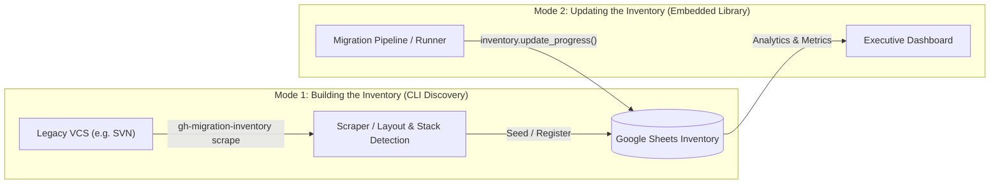
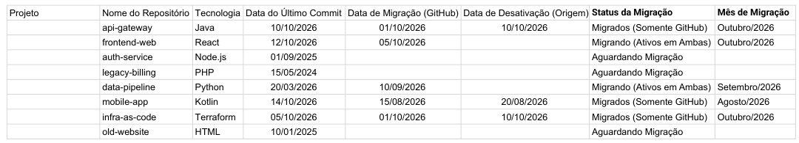
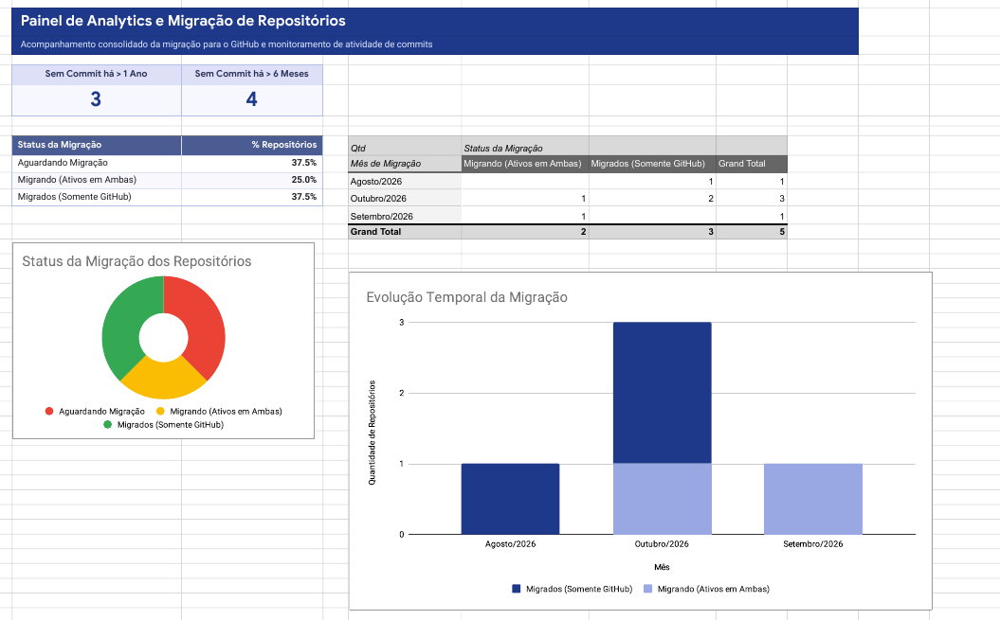

# GitHub Migration Inventory Manager

**GitHub Migration Inventory Manager** is a specialized CLI tool and Python library designed to automate the discovery of repositories across legacy version control systems (such as Subversion / SVN), register and maintain a centralized inventory in Google Sheets, and programmatically track repository migration lifecycles during large-scale enterprise GitHub migrations.

---

## Why It Was Created

In enterprise GitHub migration initiatives, organizations often need to migrate hundreds or thousands of repositories scattered across legacy VCS platforms (e.g., Subversion / SVN, GitLab, Bitbucket). These migrations present critical operational challenges:

- **Lack of Central Visibility**: Legacy servers frequently host undocumented repositories, complex grouping hierarchies (such as multi-project repositories or flat directory trees), and unidentified technology stacks. Engineering leadership lacks an authoritative, single source of truth detailing what exists, who owns it, and whether repositories are active or dormant.
- **Tracking Migration Progress Across Lifecycle States**: Migrations are iterative, phased operations rather than instantaneous cutovers. Repositories transition through progressive lifecycle stages:
  1. `Aguardando Migração` (*Waiting*): Discovered in the legacy system and queued for migration.
  2. `Migrando (Ativos em Ambas)` (*Active in Both*): Synchronized or mirrored to GitHub; active development or verification occurs in both systems during the transition window.
  3. `Migrados (Somente GitHub)` (*Migrated*): Migration complete and verified; the legacy origin repository is deactivated or archived.
  4. `Ignorado` (*Skipped*): Deprecated, empty, or obsolete codebases explicitly excluded from migration.
- **Keeping the Inventory Continuously Up to Date**: Without automation, static tracking sheets fall out of sync almost immediately. Migration teams need a live, automated inventory connected directly into their migration pipelines to update repository statuses, record exact migration and deactivation dates, generate monthly cohorts, and provide executive visibility through real-time analytics.

---

## Two Core Modes of Operation

The project is structured around two distinct operational modes that cover the entire migration lifecycle:



### 1. Building the Inventory (Discovery & Scraper Mode)
- **Form**: Command-Line Interface (`gh-migration-inventory scrape <platform>`).
- **Role**: Traverses remote VCS servers, inspects layouts (`standard`, `multi_project`, `flat`, `collection`), identifies technology stacks (Java, Python, TypeScript, C#, Bash, Terraform), extracts last commit dates, and seeds or synchronizes the Google Sheets inventory with an initial status (`waitting`).
- **Idempotency**: Running discovery multiple times is non-destructive—newly discovered repositories are added, while existing repositories maintain their current migration statuses and historical timestamps.

### 2. Updating the Inventory (Lifecycle Tracking via Embedded Library)
- **Form**: Python library ([`gh_migration_inventory_manager`](file:///media/jackson/support-storage/git-repos/ilegra/gh-migration-inventory-manager/src/gh_migration_inventory_manager)) embedded directly into migration pipelines, GitHub Actions workflows, Jenkins jobs, or automation scripts.
- **Role**: Programmatically advances repository statuses as migration steps complete (`waitting` → `active_in_both` → `migrated`). It automatically handles timestamp tracking (`Data de Migração (GitHub)`, `Data de Desativação (Origem)`) and calculates the migration month (`Mês de Migração`).

---

## How to Use It

### 3.1 Building the Inventory

The discovery CLI automatically scans remote repositories and populates the Google Sheets inventory.

#### Step 1: Prepare the Google Spreadsheet

You can use the provided example template spreadsheet as the foundation for your inventory:

1. Open the [Example Google Spreadsheet Template](https://docs.google.com/spreadsheets/d/1Z0PAjv8KK6WBrS2356gtR3VE0ulD1-8LM4DPQiG-Nkk).
2. In Google Sheets, click **File > Make a copy** to create your own copy in Google Drive.
3. Share your copied spreadsheet with your Google Cloud Service Account:
   - Click **Share** in the upper right.
   - Enter your service account's email address (found in your `gcp-key.json` as `client_email`).
   - Grant the role **Editor** and save.
4. Copy the **Spreadsheet ID** from your browser URL:
   ```text
   https://docs.google.com/spreadsheets/d/<SPREADSHEET_ID>/edit
   ```

##### Spreadsheet Structure

The template contains two worksheets:

1. **`Inventario`**: The core tracking tab populated with 8 standard columns:
   - `Projeto`: Project or business unit grouping.
   - `Nome do Repositório`: Repository or component identifier.
   - `Tecnologia`: Detected technology stack (e.g., `Java`, `Python`, `Node.js`, `Terraform`).
   - `Data do Último Commit`: Timestamp of the latest commit detected on the source.
   - `Data de Migração (GitHub)`: Date when the repository was migrated to GitHub.
   - `Data de Desativação (Origem)`: Date when the legacy origin repository was deactivated.
   - `Status da Migração`: Current lifecycle state (`Aguardando Migração`, `Migrando (Ativos em Ambas)`, `Migrados (Somente GitHub)`, `Ignorado`).
   - `Mês de Migração`: Migration month cohort (e.g., `Outubro/2026`).

   

2. **`Analytics`**: Executive dashboard with consolidated metrics and charts:
   - Commit staleness indicators (*Sem Commit há > 1 Ano*, *Sem Commit há > 6 Meses*).
   - Migration status distribution chart.
   - Monthly migration progress timeline.

   

#### Step 2: Run the Scraper CLI

Run the scraper CLI to discover repositories on the remote VCS and synchronize them directly to your Google Sheet:

```bash
poetry run gh-migration-inventory scrape svn \
  --url https://svn.internal.company.com/svn/core-apps \
  --username "$SVN_USER" \
  --password "$SVN_PASSWORD" \
  --organization "Engineering" \
  --spreadsheet-id "$SPREADSHEET_ID" \
  --credentials-path "./gcp-key.json" \
  --sheet-name "Inventario"
```

##### Command Output

Upon successful completion, the CLI prints the total count of inventoried items:

```text
14
```

#### Scraper CLI Options Reference

```bash
gh-migration-inventory scrape <platform> [OPTIONS]
```

##### Platform Options (SVN)

| Option | Default | Description |
| :--- | :--- | :--- |
| `--url <URL>` | *(Required)* | SVN repository or server URL (`http://` or `https://`) |
| `--layout <TYPE>` | `auto` | Repository layout: `auto`, `standard`, `multi_project`, `flat`, `collection` |
| `--username <USER>` | — | HTTP Basic authentication username |
| `--password <PASS>` | — | HTTP Basic authentication password |
| `--token <TOKEN>` | — | HTTP Bearer/PAT token |
| `--organization <ORG>` | — | Organization name tag for discovered repositories |
| `--project <PROJECT>` | — | Project name override for discovered repositories |

##### SVN Layout Types

- **`auto`** *(default)*: Dynamically inspects the repository root. If `trunk/`, `branches/`, or `tags/` are present, it selects `standard`. If subdirectories contain `trunk/`, it selects `multi_project`. Otherwise, it falls back to `flat`.
- **`standard`**: Classic single-project SVN structure with `/trunk`, `/branches`, and `/tags`.
- **`multi_project`**: Repository holding multiple projects where each subfolder contains its own `/trunk`.
- **`flat`**: Repository without branch folders; the root represents source code directly.
- **`collection`**: Top-level server directory hosting multiple distinct SVN repositories.

##### Google Sheets Synchronization Options

| Option | Default | Description |
| :--- | :--- | :--- |
| `--spreadsheet-id <ID>` | *(Required)* | Target Google Spreadsheet ID |
| `--credentials-path <PATH>` | *(Required)* | Path to GCP Service Account JSON key file |
| `--sheet-name <NAME>` | `Inventario` | Google Sheets worksheet/tab name |
| `--initial-status <STATUS>` | `waitting` | Initial status for newly discovered repositories (`waitting`, `waiting`, `active_in_both`, `migrated`, `skipped`) |

---

### 3.2 Updating the Inventory (Embedded Library)

In automated migration pipelines (e.g., GitHub Actions, Jenkins, or custom migration scripts), the [`gh_migration_inventory_manager`](file:///media/jackson/support-storage/git-repos/ilegra/gh-migration-inventory-manager/src/gh_migration_inventory_manager) package is embedded as a library to advance repository migration statuses as steps complete.

#### Migration Status Lifecycle & Automated Timestamps

The library automatically manages timestamps when updating status:

| Transition Status | Spreadsheet Label | Automatic Timestamp Behavior |
| :--- | :--- | :--- |
| `MigrationStatus.WAITTING` (`"waitting"`) | `Aguardando Migração` | Default initial state; timestamps remain empty. |
| `MigrationStatus.ACTIVE_IN_BOTH` (`"active_in_both"`) | `Migrando (Ativos em Ambas)` | Sets `Data de Migração (GitHub)` to current UTC timestamp and formats `Mês de Migração` (e.g. `Outubro/2026`). |
| `MigrationStatus.MIGRATED` (`"migrated"`) | `Migrados (Somente GitHub)` | Sets `Data de Desativação (Origem)` to current UTC timestamp. If migration date was not set, sets it as well. |
| `MigrationStatus.SKIPPED` (`"skipped"`) | `Ignorado` | Clears migration timestamps. |

#### Python Library Usage Example

```python
from gh_migration_inventory_manager import (
    Credentials,
    Inventory,
    MigrationStatus,
    Spreadsheet,
)

# 1. Initialize Google credentials and spreadsheet client
credentials = Credentials(credentials_path="gcp-key.json")
spreadsheet = Spreadsheet(
    id="1Z0PAjv8KK6WBrS2356gtR3VE0ulD1-8LM4DPQiG-Nkk",
    credentials=credentials,
    sheet_name="Inventario",
)

# 2. Instantiate inventory manager
inventory = Inventory(spreadsheet=spreadsheet)

# 3. Step A: Mark repository as active in both systems (mirrored / dual-run)
record = inventory.update_progress(
    repository_name="api-gateway",
    status=MigrationStatus.ACTIVE_IN_BOTH,
)
print(f"Repository: {record.name}")
print(f"Status: {record.migration_status.to_sheet_label()}")  # Migrando (Ativos em Ambas)
print(f"GitHub Migration Date: {record.gh_migration}")
print(f"Migration Month: {record.migration_month}")          # e.g. Outubro/2026

# 4. Step B: Mark repository as fully migrated and origin deactivated
completed = inventory.update_progress(
    repository_name="api-gateway",
    status=MigrationStatus.MIGRATED,
)
print(f"Origin Deactivation Date: {completed.origin_deactivation}")

# 5. Query repository record anytime
existing = inventory.get_repository(repository_name="api-gateway")
if existing:
    print(f"Current Status: {existing.migration_status.to_sheet_label()}")
```

> [!NOTE]
> Re-running the discovery scraper will **never** overwrite statuses or timestamps already updated by your migration pipeline. Existing records have their migration status and dates strictly preserved.

---

## Supported Platform Scrapers

The library uses a decoupled provider architecture ([`ScraperProvider`](file:///media/jackson/support-storage/git-repos/ilegra/gh-migration-inventory-manager/src/gh_migration_inventory_manager/scrap.py) & [`ScraperRegistry`](file:///media/jackson/support-storage/git-repos/ilegra/gh-migration-inventory-manager/src/gh_migration_inventory_manager/scrap.py)) where scrapers act as discovery adapters. They normalize external platform structures into standard repository representations ([`Repository`](file:///media/jackson/support-storage/git-repos/ilegra/gh-migration-inventory-manager/src/gh_migration_inventory_manager/scrap.py)) and detect technology stacks, independent of the inventory tracking backend.

| Platform | Scraper Identifier | Status | Layout Detection | Tech Stack Detection |
| :--- | :--- | :--- | :--- | :--- |
| **Subversion (SVN)** | `svn` | Built-in | `auto`, `standard`, `multi_project`, `flat`, `collection` | Java, Python, TypeScript, C#/.NET Core, Bash, Terraform |
| **Custom / External Platforms** | Pluggable | Supported via `ScraperRegistry` | User-defined | Adapter-defined |

---

## Installation & Setup

### Prerequisites

- Python `>= 3.10`
- [Poetry](https://python-poetry.org/) `>= 2.0`

### 1. Install Dependencies & Virtual Environment

```bash
# Clone the repository
git clone git@github.com:ilegra/gh-migration-inventory-manager.git
cd gh-migration-inventory-manager

# Install dependencies into local .venv
poetry install --with dev
```

### 2. Set Up Pre-Commit Hooks (including Secret Detection)

```bash
# Install git hooks
poetry run pre-commit install

# Test hooks across all files
poetry run pre-commit run --all-files
```

---

## Running Quality Checks Locally

```bash
# Linting & Formatting Check
poetry run ruff check src tests
poetry run ruff format --check src tests

# Static Type Checking
poetry run mypy src tests

# Security Scanning
poetry run bandit -r src
```

---

## Running Tests

```bash
# Unit Tests
poetry run pytest tests/unit -v

# Integration Tests (Requires Docker and GCP credentials)
poetry run pytest tests/integration -v
```

---

## Building the Library Package

```bash
poetry build
```

This produces ready-to-distribute wheels and source archives in `dist/`:
- `dist/gh_migration_inventory_manager-<version>-py3-none-any.whl`
- `dist/gh_migration_inventory_manager-<version>.tar.gz`

---

## Features

- **Isolated Environment**: Poetry with in-project virtual environment (`.venv`).
- **Standard Public Library Interface**: Clean `gh_migration_inventory_manager` package export with PEP 561 typing support (`py.typed`).
- **Pluggable Platform Scrapers**: Modular discovery adapters (`ScraperRegistry` & `ScraperProvider`) for platforms like Subversion (SVN) with automatic layout detection and technology stack analysis.
- **Unified CLI (`gh-migration-inventory`)**: Discover remote repositories across VCS platforms and synchronize directly with Google Sheets.
- **Comprehensive Quality Gates**: Formatted with Ruff, typed with Mypy, and secured with Gitleaks & Bandit.
- **Git Pre-commit Hook**: Scans every commit for secret leaks with Gitleaks before commits are finalized.
- **Automated CI/CD Workflows**:
  - `ci.yaml`: Runs full quality + security gates on PRs and merges to `main`.
  - `cd.yaml`: Bumps version, creates Git tags, builds `.whl` and `.tar.gz` packages, and publishes GitHub releases with artifacts.

---

## License

This project is licensed under the Apache 2.0 License.
